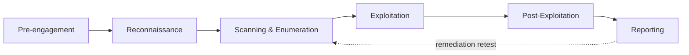

# The Penetration Testing Lifecycle

A penetration test is not "poke at things until something breaks." It is a repeatable process with
defined phases, each feeding the next. Following the process is what makes a test thorough (you
don't miss a whole class of target), repeatable (another tester would cover the same ground), and
defensible (you can show exactly what you did and when). This lesson gives you the map; the rest of
the course fills in each phase.

## The phases

Different frameworks name them slightly differently, but every professional methodology has the
same shape:

1. **Pre-engagement.** Scope, authorization, rules of engagement, timelines, emergency contacts
   (Level 1 lesson 1; Level 4 lesson 3). Nothing technical happens until this is signed.
2. **Reconnaissance.** Gather information about the target — passively first (OSINT, no packets to
   the target) then actively. What domains, hosts, people and technologies exist?
3. **Scanning & Enumeration.** Identify live hosts, open ports, running services and their
   versions. Turn "a network" into "a specific list of services with specific versions."
4. **Exploitation (gaining access).** Use a weakness in an enumerated service to gain a foothold —
   a shell, a login, a database connection.
5. **Post-exploitation.** With a foothold, determine impact: what can be reached from here, what
   data is exposed, can you escalate privileges or move laterally? This is where you measure *how
   bad* a finding really is.
6. **Reporting.** Write it up: what you found, how serious each finding is, how to reproduce it, and
   how to fix it. This is the deliverable the client pays for (Level 4 lesson 2).

The dashed line is the **remediation retest**: after the client fixes the findings, you often
re-run the relevant phases to confirm the fixes work.

## The frameworks

You do not have to invent this process. Two widely used references:

- **PTES — Penetration Testing Execution Standard.** Defines seven stages: pre-engagement
  interactions, intelligence gathering, threat modeling, vulnerability analysis, exploitation,
  post-exploitation, and reporting. It is a practical, engagement-oriented standard.
- **OSSTMM — Open Source Security Testing Methodology Manual.** A more formal, metrics-driven
  methodology that emphasises measurable results and repeatability across many channels (not just
  networks).

For web applications specifically, the **OWASP Web Security Testing Guide (WSTG)** and the **OWASP
Top 10** give a testing checklist tailored to web apps — you will use these heavily in Level 2.

!!! note "Frameworks are maps, not scripts"
    You don't rigidly march through every item on every test. You use the framework to make sure
    you *considered* each area, then spend your time where the target is actually weak. The value is
    in not missing a whole category because you got absorbed in one finding.

## Why the order matters

The phases are ordered because each depends on the last. You cannot enumerate services on hosts you
have not discovered; you cannot exploit a service whose version you have not identified; you cannot
assess impact before you have a foothold; you cannot write a useful report before you know the
impact. Testers who jump straight to "exploit" skip the enumeration that tells them *what* to
exploit — and then wonder why they are firing random exploits at closed ports.

## A worked example (lab)

Suppose your lab target is a single Metasploitable box. The lifecycle in miniature:

| Phase | What you do | Output |
|-------|-------------|--------|
| Pre-engagement | (In the lab, you own it — but note scope: just this one host.) | Target: `192.168.56.101` only |
| Recon | Nothing to OSINT in a lab; you'd gather public info for a real target | — |
| Scanning | `nmap -sV 192.168.56.101` | A list of open ports and service versions |
| Enumeration | Dig into each service — banner, shares, web paths | Named services, versions, likely weak points |
| Exploitation | Use a known-vuln service to get a shell | A foothold |
| Post-exploitation | Check privileges, look for other hosts, sensitive files | Impact assessment |
| Reporting | Write each finding with reproduction and fix | The deliverable |

The next seven lessons walk the early phases in detail; Levels 2–4 cover exploitation,
post-exploitation and reporting.

## How It Actually Works

The lifecycle is really an **information-refinement pipeline**. You start with almost nothing (a
scope document) and at each phase you convert broad, uncertain information into narrower, more
certain information:

- Recon turns "this organisation" into "these domains, hosts and technologies."
- Scanning turns "these hosts" into "these open ports."
- Enumeration turns "these ports" into "these exact service versions and configurations."
- Exploitation turns "this vulnerable version" into "this access."
- Post-exploitation turns "this access" into "this business impact."

Each arrow is a reduction in uncertainty paid for with effort and (from the target's side) with
traffic. That is why recon starts *passive*: information you can get without sending a single packet
to the target costs the target nothing and reveals nothing about you. Only when passive sources are
exhausted do you spend "louder," more detectable active techniques. A skilled tester is
economical — they gather the cheap information first so that by the time they are making noise, they
already know exactly where to aim.

Reporting sits at the end because it consumes the *entire* pipeline: a finding is only useful if you
can state the service, the weakness, the access it granted, and the impact — which is precisely the
chain the earlier phases built. This is why sloppy note-taking early ruins the report later; the
report is assembled from evidence captured phase by phase.

## Common mistakes and pitfalls

- **Skipping enumeration to rush to exploitation.** You end up guessing. Enumerate first; the
  weakness usually announces itself.
- **Not keeping phase-by-phase notes.** The report is built from them. Screenshot and log as you
  go, with timestamps.
- **Treating recon as a one-time step.** New information from later phases (a hostname found in a
  config file, say) feeds back into recon. The pipeline loops.
- **Confusing "I got a shell" with "I'm done."** Exploitation is the middle, not the end.
  Post-exploitation measures the actual impact, which is what the client needs to know.
- **Following the framework so rigidly you waste the whole budget on low-value checks.** Use it to
  ensure coverage, then prioritise.

## Exercise

1. Draw the six-phase lifecycle from memory and write one sentence describing the output of each
   phase.
2. Pick one framework (PTES or OSSTMM), find its official documentation, and list its stages. Note
   one way it is more detailed than the six-phase model in this lesson.
3. For your lab target, write a one-line plan for each phase (what tool or action you'd use). You
   will execute this plan over the next several lessons.
4. Explain, using the *information-refinement* idea, why reconnaissance begins with passive sources
   before any active scanning.
