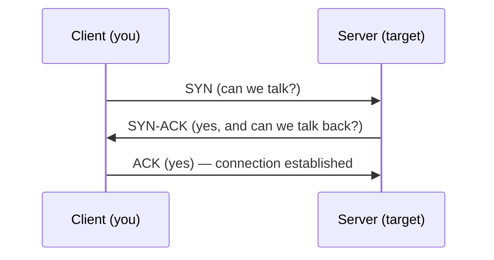

# Networking Through a Tester's Lens

Scanning, enumeration and exploitation are all conversations over a network, so you have to
understand the network well enough to know what your tools are doing and why a target responds the
way it does. This lesson is TCP/IP seen from the attacker's chair: not an exhaustive networking
course, but the parts that explain *why a SYN scan works*, *what an open port actually is*, and
*what each layer leaks*. The broader
[Cybersecurity Mastery Path](https://sigilipelli.github.io/cybersecurity-mastery-path/) covers
defensive network security; here we stay on what a tester needs to drive the next six lessons.

## The layers, briefly

Networking is built in layers, each wrapping the one above:

| Layer (TCP/IP model) | Unit | Examples | What it gives a tester |
|----------------------|------|----------|------------------------|
| Application | data | HTTP, DNS, SSH, SMB | The actual service to attack |
| Transport | segment | TCP, UDP + **ports** | Which services are reachable |
| Internet | packet | IP, ICMP | Which hosts exist and are up |
| Link | frame | Ethernet, ARP, Wi-Fi | Local-network attacks, MAC addresses |

When you browse `http://target/`, your request is HTTP (application), carried in a TCP segment
(transport) to port 80, inside an IP packet (internet) addressed to the target, inside Ethernet
frames (link) on the wire. Each layer adds a header; the receiver peels them off in reverse. A
tester attacks at whichever layer is weakest.

## IP addresses and subnets

An IPv4 address is four octets, e.g. `192.168.56.101`. A **subnet mask** (or CIDR suffix like
`/24`) says how much of the address is the network and how much is the host:

- `192.168.56.0/24` → the first 24 bits are the network, leaving 8 bits (256 addresses,
  `.0`–`.255`) for hosts. This is a typical home-lab host-only range.
- `/16` → 65,536 addresses; `/8` → ~16 million.

Testers care because scope is usually given as CIDR ranges, and Nmap scans them directly:
`nmap 192.168.56.0/24` sweeps all 256 addresses.

**Private ranges** (`10.0.0.0/8`, `172.16.0.0/12`, `192.168.0.0/16`) are not routable on the
internet — they live behind NAT on internal networks. Finding private IPs in recon tells you about
internal structure.

## Ports: the heart of scanning

A single host runs many services, so the transport layer multiplexes them by **port number**
(0–65535). A service *listens* on a port; a client *connects* to it. Well-known ports:

| Port | Service | Port | Service |
|------|---------|------|---------|
| 21 | FTP | 443 | HTTPS |
| 22 | SSH | 445 | SMB |
| 23 | Telnet | 3306 | MySQL |
| 25 | SMTP | 3389 | RDP |
| 53 | DNS | 5432 | PostgreSQL |
| 80 | HTTP | 8080 | HTTP (alt) |

"Scanning a host" means asking each port "are you listening?" An **open** port is a listening
service — an entry point. A **closed** port responds but has nothing listening. A **filtered** port
gives no useful answer, usually because a firewall dropped the probe. The whole of the next two
lessons is about producing an accurate list of open ports and the services behind them.

## The TCP three-way handshake

TCP is connection-oriented: before any data flows, both sides perform a handshake.

1. Client sends **SYN** (synchronise) to the target's port.
2. If a service is listening, the target replies **SYN-ACK**.
3. Client replies **ACK**, and the connection is established; data can flow.

That exchange is the key to port scanning. A **SYN scan** sends step 1 and watches the reply:

- **SYN-ACK back** → something is listening → the port is **open**.
- **RST (reset) back** → nothing listening → the port is **closed**.
- **nothing back** → a firewall likely dropped it → **filtered**.

The scanner then usually sends a RST instead of completing step 3, so the connection is never fully
established — faster, and historically stealthier. You will run exactly this in the next lesson.

## UDP is different

UDP is connectionless — no handshake. You send a datagram and may or may not get a reply. That makes
UDP scanning slow and ambiguous: an open UDP port often stays silent, and "no reply" could mean open
or filtered. DNS (53), SNMP (161) and DHCP (67/68) are important UDP services worth scanning despite
the hassle.

## How It Actually Works

Why does sending just a SYN tell you a port is open without ever establishing a connection? Because
the target's TCP stack is a state machine that reacts to the SYN **before any application is
involved**. When a SYN arrives for a port where a service has called `listen()`, the operating
system's TCP stack itself replies SYN-ACK — the listening application hasn't been handed anything
yet; it only gets the connection after the handshake completes with `accept()`. So the SYN-ACK is
the *kernel* telling you "a program has reserved this port," which is exactly the fact you want. If
no program has reserved the port, the kernel replies RST ("go away, nobody's here"). And if a packet
filter in between silently drops the SYN, nothing comes back at all — hence "filtered" is the
absence of a reply.

This is also why a SYN scan is lighter than a full connect: by not sending the final ACK, the
scanner never completes the handshake, so the target's application layer is never notified of a
connection at all. The kernel may briefly hold a half-open connection, but no log entry from the
*service* is generated the way a completed connection would produce one. (Modern monitoring catches
SYN scans anyway, so "stealth" is relative — but the mechanism is why the technique exists.)

The layered model underlies all of it: the scanner operates at the transport layer (crafting TCP
flags), learns which application-layer services exist, and relies on the internet layer to get
packets to the right host. Understanding which layer you're at tells you which tool and which attack
applies.

## Common mistakes and pitfalls

- **Confusing "closed" with "filtered."** Closed means the host answered "nothing here"; filtered
  means something ate your probe. They imply very different things about firewalls.
- **Expecting UDP scans to be fast or definitive.** They are neither. Budget time and corroborate.
- **Scanning the network address or broadcast address** (`.0` and `.255` in a `/24`) and expecting
  a host. Those are special.
- **Forgetting that a service can listen on a non-standard port.** Port 22 is *usually* SSH, but a
  service can bind anywhere. Never assume the service from the port number alone — the next lesson's
  version detection is how you confirm.
- **Ignoring the link layer in a local test.** On the same subnet, ARP and MAC-level techniques
  matter; Nmap uses ARP for host discovery on a local network precisely because it's reliable there.

## Exercise

1. For the CIDR `10.10.10.0/24`: how many addresses does it contain, which is the network address,
   and which is the broadcast address?
2. Draw the three-way handshake from memory, labelling each message, then annotate what a SYN scan
   sends and what each possible reply (SYN-ACK / RST / nothing) means.
3. On your lab, run `ss -tlnp` on a target VM to see which ports *it* thinks are listening, then
   predict what a scan from the attacker will show. (You'll test the prediction next lesson.)
4. Explain in your own words why the target's *kernel*, not the listening application, is what
   replies to a SYN — and why that makes a SYN scan possible without completing a connection.
