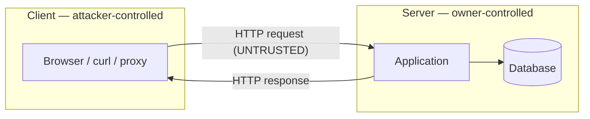

# How Web Apps Work & the Testing Mindset

Before you can test a web application you have to see it the way a tester does: as a client and a
server exchanging HTTP messages across a trust boundary, where **everything the client sends can be
changed by the client.** Most web vulnerabilities come down to a server trusting data it should not
trust. This lesson builds that mental model; the rest of Level 2 attacks specific instances of it,
all against deliberately vulnerable practice apps you run yourself.

## The request/response cycle

A web app is a conversation in HTTP. The browser sends a **request**; the server returns a
**response**.

```
GET /profile?id=42 HTTP/1.1
Host: app.lab
Cookie: session=abc123
User-Agent: Mozilla/5.0

```
```
HTTP/1.1 200 OK
Content-Type: text/html
Set-Cookie: session=abc123; HttpOnly

<html>…</html>
```

Key parts a tester cares about:

- **Method** — `GET` (retrieve, parameters in the URL), `POST` (submit, parameters in the body),
  plus `PUT`, `DELETE`, `PATCH` for APIs.
- **Path and query string** — `/profile?id=42`. Those parameters are attacker-controllable.
- **Headers** — `Host`, `Cookie`, `User-Agent`, `Referer`, `Authorization`. *All* client-sent, all
  changeable.
- **Body** — form fields or JSON on POST/PUT. Changeable.
- **Status code** — 200 OK, 302 redirect, 401 unauthorized, 403 forbidden, 404 not found, 500 error.
  The codes leak a lot about app behaviour.
- **Response headers** — `Set-Cookie`, security headers (`Content-Security-Policy`,
  `Strict-Transport-Security`), `Server`.

## Statelessness and sessions

HTTP is **stateless** — each request is independent; the server does not inherently remember you
between requests. Applications fake continuity with **sessions**: on login the server issues a
session identifier (usually in a cookie), and the browser sends it back on every subsequent request.
The server looks the ID up to know who you are.

This single mechanism is the target of a whole class of attacks: steal or guess the session ID and
you *are* that user. Hence cookie flags matter — `HttpOnly` (JavaScript can't read it, blunting
XSS theft), `Secure` (only sent over HTTPS), `SameSite` (limits cross-site sending, blunting CSRF).

## The trust boundary — the single most important idea

Draw a line between the **client** (browser, under the user's — and attacker's — full control) and
the **server** (under the app owner's control). That line is the **trust boundary.** The rule:

> Anything that crosses from client to server is untrusted. The server must validate and handle it
> as potentially hostile — *every* time.

"Anything" is literal: URL parameters, form fields, JSON bodies, cookies, every header, uploaded
files, even values your own JavaScript set a moment ago. The attacker doesn't use your JavaScript or
your form; they send raw HTTP with whatever values they like.



## Why client-side validation is not security

A form might use JavaScript to require a valid email or block a negative quantity. That is a *user
experience* feature, not a security control, because the attacker can:

- disable JavaScript,
- edit the request in an intercepting proxy (next lesson) after validation runs,
- or skip the browser entirely and send the request with `curl`.

```bash
# The browser's JS said quantity must be 1-10. The attacker just sends -5:
curl -X POST http://app.lab/cart -d 'item=книга&qty=-5'
```

If the server didn't re-check, the negative quantity lands in the app. **Every** validation that
matters must happen on the server side, after the trust boundary. Client-side checks are fine as a
convenience *in addition*, never *instead*.

## The testing mindset

Testing a web app is systematic curiosity about that trust boundary:

1. **Map the app** — every page, parameter, form, endpoint, and the roles/permissions involved.
2. **Identify inputs** — everything that crosses the boundary (params, headers, cookies, bodies,
   files).
3. **For each input, ask "what if I send something unexpected?"** — a quote, a script tag, another
   user's ID, a huge value, the wrong type.
4. **Observe the response** — errors, reflected input, different behaviour, timing changes.
5. **Confirm impact** without causing harm, and note the fix.

The OWASP **Web Security Testing Guide (WSTG)** turns this into a thorough checklist; the OWASP
**Top 10** is the shortlist of the most impactful categories, which structure the rest of this
level.

## How It Actually Works

Why is "the server must not trust the client" such an unavoidable rule — why can't the app just
*make* the client trustworthy? Because of where code runs. The browser, the HTML, the JavaScript,
the form constraints — all of it executes on the **user's machine**, inside software the user fully
controls. The server hands the client a *suggestion* of how to behave (a form with a `maxlength`, a
script that validates), but it has no power to enforce that the client followed it. By the time a
request arrives at the server, it is just bytes on a socket; the server cannot tell whether those
bytes came from the official form, a modified page, a proxy, or `curl`. There is no cryptographic
proof that "this request obeyed my JavaScript," and there cannot be one, because the attacker owns
the environment that JavaScript ran in.

So the trust boundary isn't a design choice an app can opt out of — it is a physical fact of the
client/server split. The only place the application can *enforce* a rule is on hardware it controls,
which is the server. Everything sent from the client is, from the server's perspective, an
assertion by a potentially hostile party. Every web vulnerability in this level is ultimately a
server that forgot this and trusted an assertion: trusted that input was safe text (injection,
XSS), trusted that a user asking for record 43 owned record 43 (access control), trusted that a URL
it was told to fetch was harmless (SSRF). Seeing the trust boundary clearly is what lets you predict
where the bugs will be before you even send a request.

## Common mistakes and pitfalls

- **Thinking the attacker uses your UI.** They use raw HTTP. Any constraint that lives only in the
  browser doesn't exist for them.
- **Testing only the parameters the form exposes.** Hidden fields, cookies and headers cross the
  boundary too, and are often less defended.
- **Trusting status codes at face value.** A 200 with an error message in the body, or a 302 that
  still leaked data first, both matter. Read the whole response.
- **Forgetting that `GET` parameters end up in logs and history.** Sensitive data in a query string
  is itself a finding.
- **Confusing encoding with security.** Base64 or URL-encoding a parameter hides nothing from an
  attacker who can decode it; it is not a control.

## Exercise

1. Using `curl -v`, request any page of a web app you run locally and read the full request and
   response. Identify the method, three request headers, the status code, and two response headers.
2. For a login form on a local practice app, list every input that crosses the trust boundary — not
   just the visible fields. Include cookies and relevant headers.
3. Take a form with a client-side constraint (a number field, a dropdown) and submit a value that
   violates it using `curl`, bypassing the browser. Describe what the server did with it.
4. Draw the trust-boundary diagram for a page that reads `?id=` and returns a record. Mark which
   values are untrusted.
5. Explain, in your own words, why the server *cannot* enforce a rule that lives only in client-side
   JavaScript, referencing where that code runs.
