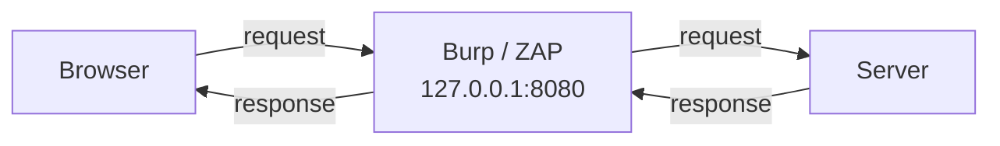

# Using an Intercepting Proxy

The last lesson said the attacker edits requests after the browser's JavaScript has run. The tool
that makes this easy is an **intercepting proxy** — software that sits between your browser and the
server, catching every request so you can read it, change it, and send it on. It is the single most
used tool in web testing. The two standards are **Burp Suite** (Community edition is free; a paid
Professional edition adds an active scanner) and **OWASP ZAP** (fully free and open source). This
lesson explains how they work and how to drive the core workflow; use either against your own
practice apps.

## The setup

Normally your browser talks straight to the server. With a proxy, you point the browser at the
proxy (commonly `127.0.0.1:8080`), and the proxy forwards traffic:

Because every byte passes through the proxy, you can pause a request ("intercept"), edit any part
of it, then forward it — landing arbitrary values on the server regardless of what the page allowed.

### Configuring it

1. Start Burp or ZAP; note its listener (default `127.0.0.1:8080`).
2. Point your browser's proxy at that address. Use a dedicated browser or a profile so you don't
   proxy your normal browsing. (Burp ships with a preconfigured embedded browser; ZAP has an
   equivalent.)
3. For HTTPS, install the proxy's CA certificate in the browser (see below).

## The core tools

Both proxies share the same conceptual tools (names differ slightly):

- **Proxy / Intercept** — catch requests in flight; edit and forward, or drop.
- **HTTP history / Sitemap** — a log of everything that passed through, building a map of the app.
- **Repeater (Burp) / Manual Request Editor (ZAP)** — resend a single request over and over with
  tweaks. This is where most manual testing happens: change one parameter, send, read the response,
  repeat.
- **Intruder (Burp) / Fuzzer (ZAP)** — automate sending many variations of a request (a wordlist of
  payloads into one parameter) to find which inputs change behaviour.
- **Decoder / Encoder** — base64, URL, HTML, hex transforms on selected data.
- **Comparer** — diff two responses to spot subtle differences.

A typical manual-testing loop: browse the app through the proxy (populating history), find an
interesting request, send it to Repeater, then mutate one input at a time and watch the response.

## HTTPS interception

To read HTTPS, the proxy performs a **deliberate, local man-in-the-middle**: it presents its *own*
certificate to your browser for each site, decrypts the traffic, then re-encrypts it to the real
server. Your browser will reject the proxy's cert until you install the proxy's CA certificate as
trusted. You are intercepting *your own* browser's traffic to *your own* test target — that is the
legitimate use. (Doing this to someone else's traffic without authorization is interception, and
illegal.)

## Scope — keep the proxy pointed at the target

Both tools let you set a **target scope** so the proxy only acts on in-scope hosts. Set it. Without
scope, the proxy logs and may auto-scan every site the browser touches — including out-of-scope
analytics, CDNs, and your own webmail if you forgot to switch browsers. On a real engagement, an
out-of-scope auto-scan is an incident. In the lab, build the habit anyway.

!!! warning "Never run an active scan outside scope"
    Burp Pro's scanner and ZAP's active scan send real attack payloads. Only point them at targets
    you own or are explicitly authorized to test, and only when the RoE permits automated scanning.
    In this course, that means your practice apps.

## A worked example

You're testing a price field on a local shop app. In the browser, the quantity is capped at 10 and
the price is not editable at all. Through the proxy:

1. Add an item to the cart; the POST appears in HTTP history.
2. Send it to Repeater. You see `item=5&qty=3&price=1999`.
3. The `price` field was never meant to be client-controlled, but it's in the request. Change it to
   `price=1`, forward, and read the response.
4. If the server trusts the submitted price (a real and common flaw), the cart now shows ₹1. That's
   a confirmed business-logic/access-control finding — proven with a single edited request, no
   browser trickery needed.

You would document the request, the response, the impact, and the fix (the server must look up the
price from its own database, never trust a client-sent price).

## How It Actually Works

A proxy is just a program that speaks HTTP on both sides. When your browser is configured to use it,
the browser sends its request *to the proxy* (for plain HTTP, the request line even contains the
full URL so the proxy knows where to forward it). The proxy holds that request in memory — which is
all "intercept" is: not forwarding yet — and exposes it to you as editable text. When you forward
it, the proxy opens its own connection to the real server and relays your (possibly modified) bytes.
The server cannot tell the request came via a proxy; it sees a normal HTTP request. This is why the
server's defences must be server-side: the proxy has stripped away every client-side constraint
simply by letting you retype the request.

HTTPS seems like it should block this — the whole point of TLS is that nobody in the middle can read
or alter the traffic. The proxy gets around it not by breaking TLS but by **being a party to two
separate TLS connections**: browser↔proxy and proxy↔server. For the browser↔proxy leg, the proxy
generates a certificate for the target hostname on the fly, signed by the proxy's own CA. Your
browser would normally reject that cert (it's not from a real public CA), which is exactly TLS
working as designed — so you *explicitly* install the proxy's CA as trusted on your own machine,
telling your browser "I consent to this interception." Now the browser accepts the proxy's certs,
the proxy decrypts, you read and edit plaintext, and the proxy re-encrypts to the server over the
second TLS connection. The security model isn't defeated; you have deliberately inserted yourself as
a trusted endpoint on a machine you control. That same mechanism, applied to traffic you *don't*
control and *aren't* authorized to intercept, is a crime — the technology is identical; consent and
authorization are, once again, the whole difference.

## Common mistakes and pitfalls

- **Proxying your whole system/browser** and drowning in traffic (and risking out-of-scope hosts).
  Use a dedicated browser/profile and set scope.
- **Forgetting the CA cert for HTTPS** and concluding "the proxy doesn't work" when the browser is
  just refusing the untrusted cert.
- **Leaving the intercept toggle on** and wondering why the app hangs — every request is paused
  waiting for you. Turn intercept off for normal browsing, on when you want to catch a specific
  request.
- **Running an active scanner in Community/free setups expecting Pro features** — Burp Community has
  no automated scanner; manual Repeater work is the core skill anyway.
- **Testing through the proxy but not setting scope**, then accidentally scanning a third party. In
  a real engagement this is a serious incident.

## Exercise

1. Install Burp Suite Community or OWASP ZAP. Configure a browser to use its proxy and install the
   CA certificate. Confirm you can see requests in HTTP history.
2. Browse a local practice app for two minutes, then review the HTTP history / sitemap. How many
   distinct endpoints did you discover just by browsing?
3. Pick one request, send it to Repeater/Manual Editor, change a single parameter, and resend.
   Record the before/after responses.
4. Reproduce the price-tampering example (or an equivalent) against a practice app. Document the
   edited request, the result, and the server-side fix.
5. Explain, in your own words, how the proxy reads HTTPS without "breaking" TLS, and why installing
   its CA is a consent step rather than a vulnerability.
