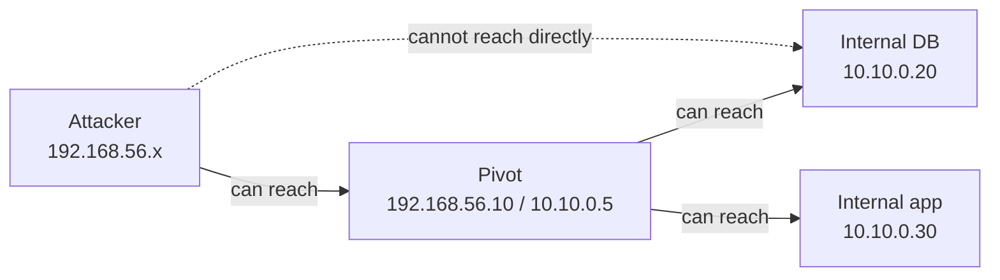

# Pivoting & Lateral Movement

A single foothold is rarely the whole network. **Pivoting** is using a compromised host as a stepping
stone to reach machines and segments you can't touch directly — because they're on an internal subnet
behind the firewall, with no route from your attacker box. **Lateral movement** is the broader act of
spreading from host to host, often using credentials gathered along the way. This lesson covers the
networking mechanics (forwarding, tunnels, SOCKS proxies) and how they chain into a path through a
segmented network. Lab only.

## The problem pivoting solves

Your attacker machine can reach the host you compromised (call it the *pivot*), but the juicy
internal systems sit on a subnet your attacker box has no route to. The pivot, however, *is* on that
subnet. Pivoting borrows the pivot's network position: you route your traffic *through* the pivot so
that, from the internal subnet's perspective, the connections come from a machine it already trusts.



The attacker can't reach `10.10.0.0/24`, but the dual-homed pivot can — so you tunnel through it.

## The core techniques

### Local port forwarding

Forward a port on your attacker machine, through the pivot, to a specific internal host:port. A
tunnel makes `localhost:8000` on your attacker box actually reach `10.10.0.20:3306` via the pivot.
Good for reaching *one* known service.

```bash
# SSH local forward via a pivot you have SSH access to (lab):
ssh -L 8000:10.10.0.20:3306 user@pivot
# Now connect your tools to 127.0.0.1:8000 to reach the internal DB.
```

### Dynamic forwarding / SOCKS proxy

A single tunnel that lets you reach *any* host:port the pivot can reach, by running a SOCKS proxy.
You point tools at the SOCKS proxy and they transparently route through the pivot. This is the
flexible workhorse for exploring an internal subnet.

```bash
# SSH dynamic (SOCKS) proxy through the pivot (lab):
ssh -D 1080 user@pivot
# Then use proxychains to send any tool through it:
proxychains nmap -sT -Pn 10.10.0.0/24
proxychains curl http://10.10.0.30/
```

`proxychains` wraps a tool and forces its TCP connections through the SOCKS proxy; now your scans and
requests originate from the pivot.

### Framework pivoting (Metasploit)

When your foothold is a Metasploit/Meterpreter session rather than SSH:

- **`autoroute`** adds a route to the internal subnet *through* the session, so Metasploit modules can
  reach it.
- **`portfwd`** forwards individual ports.
- Meterpreter's SOCKS module exposes the route to external tools via proxychains.

Dedicated tools like **Chisel**, **sshuttle** and **ligolo-ng** do the same over different transports,
useful when SSH isn't available.

## Lateral movement techniques (Windows-heavy)

Reaching a host is step one; *authenticating* to it is step two, usually with credentials gathered
earlier (lessons 3, 5, 6):

- **Pass-the-hash / pass-the-ticket** — reuse captured NTLM hashes or Kerberos tickets to log in
  without the plaintext password.
- **Remote execution** — PsExec-style service creation, WMI, WinRM/PowerShell Remoting, or RDP, using
  valid or reused credentials.
- **Credential reuse** — a local-admin password identical across machines (the LAPS-less estate from
  lesson 6) unlocks the whole fleet.

Each hop: reach the host (pivot if needed), authenticate (reused creds/hash/ticket), execute, then
gather *that* host's credentials for the next hop.

## A worked example (reasoning)

You compromise a dual-homed web server (`192.168.56.10` externally, `10.10.0.5` internally). Your
attacker box can't see `10.10.0.0/24`. You:

1. Establish a SOCKS proxy through the pivot (SSH `-D`, or Meterpreter `autoroute` + SOCKS).
2. Through proxychains, scan `10.10.0.0/24` — discovering an internal database and an app server
   invisible before.
3. Reach the internal app, exploit it (or reuse credentials found on the pivot), and gain a second
   foothold at `10.10.0.30`.
4. From there, repeat — enumerate, gather credentials, reach the next segment.

You document the topology, each pivot, and the fact that a single internet-facing host exposed an
entire internal subnet — a segmentation finding as much as an exploitation one.

## The defences

- **Network segmentation** with host-based and internal firewalls: the pivot should *not* be able to
  reach everything internally. Limit east-west traffic.
- **Least privilege and credential hygiene** (LAPS, tiering, no admin creds on low-trust hosts) so a
  foothold yields no reusable credentials for the next hop.
- **Monitor east-west traffic and authentication**: lateral movement produces unusual
  host-to-host connections and logons that stand out if anyone's watching.
- **Disable/limit remote-execution avenues** (restrict WinRM/RDP exposure, SMB signing, etc.).
- **Egress filtering** on servers — a web server generally shouldn't be opening outbound SOCKS-ish
  tunnels or reaching arbitrary internal hosts.

## How It Actually Works

Why does pivoting work at all — why can't the firewall just stop it? Because a pivot tunnel doesn't
*break* any network control; it *rides legitimate connectivity that already exists*. The firewall's
job is to enforce "who may talk to whom." It permits the attacker→pivot connection (the pivot is an
internet-facing service, meant to be reachable) and it permits the pivot→internal connections (the
pivot is an internal host that legitimately talks to the database). Pivoting simply *composes* these
two permitted legs: your traffic goes attacker→pivot (allowed) and the pivot re-originates it to the
internal host (allowed), so every individual connection the firewall sees is one it was configured to
allow. The firewall never sees a forbidden attacker→internal connection, because that connection
never exists on the wire — it's two legal connections stitched together inside the pivot. This is
exactly why segmentation is the defence: the attack depends on the pivot being *able* to reach the
internal targets, so the fix is to ensure the pivot *can't* — restrict what each host may talk to, so
that composing permitted legs doesn't reach anything sensitive.

A SOCKS proxy generalises this: instead of pre-deciding one destination (local forward), it turns the
pivot into a general-purpose relay that will connect onward to *whatever you ask*, and `proxychains`
rewrites your tools' connections to go through it. From the internal network's point of view, all the
scanning and exploitation now originates from the pivot — a host it trusts — which is why pivoted
attacks also evade source-based access controls and look, superficially, like the pivot behaving
oddly. The deeper lesson for both attacker and defender is that *network trust is transitive unless
you deliberately make it not*: if A trusts (can reach) B, and B trusts C, then compromising B grants
reach to C for free. Lateral movement is the same transitivity in the *credential* dimension (reused
hashes/passwords chaining host to host) that pivoting is in the *network* dimension. Flat networks and
reused credentials are the two forms of accidental transitivity that let one foothold become total
compromise; segmentation and credential hygiene are the two ways to cut it.

## Common mistakes and pitfalls

- **Forgetting `-Pn` and using SYN scans through a SOCKS proxy.** SOCKS proxies relay *TCP
  connections*, so use connect scans (`-sT`) and skip host discovery (`-Pn`); raw SYN/ICMP won't
  traverse the proxy.
- **Tunneling everything and losing track of the topology.** Keep a clear map of which host reaches
  which; pivots stack and it gets confusing fast.
- **Noisy, wide scans through a pivot.** They're slow over a tunnel and loud. Be targeted; you already
  know roughly what you're looking for.
- **Leaving tunnels/tools behind.** In a real engagement, clean up pivot artefacts; document what you
  placed and remove it.
- **Assuming you must crack credentials to move laterally.** Pass-the-hash/ticket often make cracking
  unnecessary (lesson 6).
- **Reporting the foothold but not the segmentation failure.** "One DMZ host could reach the entire
  internal network" is often the more important finding.

## Exercise

1. In a lab with a dual-homed pivot and an internal-only target, set up a SOCKS proxy through the
   pivot (SSH `-D` or Meterpreter). Confirm you can reach the internal target *only* through the
   proxy.
2. Run `proxychains nmap -sT -Pn` against the internal subnet and discover a host your attacker box
   couldn't see directly. Explain why `-sT -Pn` is required through SOCKS.
3. Reach and interact with an internal service through the tunnel (e.g. `proxychains curl`). Capture
   evidence that the connection originated from the pivot.
4. Explain, in your own words, why a firewall permits a pivoted connection even though it would block
   a direct attacker→internal connection.
5. Name the two kinds of "accidental transitivity" (network and credential) and the defence that cuts
   each.
